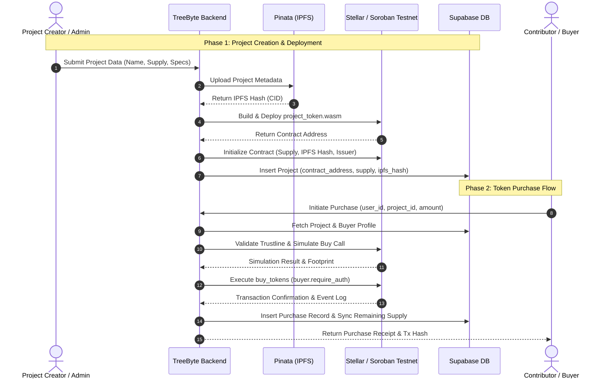

# Complete Project Tokenization & Purchase Flow

This document provides a comprehensive technical guide to the project tokenization lifecycle, Soroban smart contract deployment, supply logic, trustline verification, and database integration within TreeByte Backend.

---

## 1. Architectural Overview

TreeByte transforms physical reforestation and conservation projects in Costa Rica into verifiable digital tokens on the Stellar blockchain. The backend coordinates:
1. IPFS metadata pinning via Pinata.
2. Soroban smart contract compilation, deployment, and initialization.
3. Stellar trustline verification and transaction simulation.
4. Relational database persistence in Supabase.



---

## 2. Project Creation & Soroban Contract Deployment

Project deployment is handled by [`@/services/soroban-deployment.service.ts`](@/services/soroban-deployment.service.ts).

### 2.1 Compilation Phase
The contract source code is located in [`contracts/contracts/project-token`](contracts/contracts/project-token):
```bash
cargo build --target wasm32-unknown-unknown --release
```
The compiled bytecode output is placed in `contracts/target/wasm32-unknown-unknown/release/project_token.wasm`.

### 2.2 Deployment Phase
The WASM bytecode is uploaded and instantiated on the Stellar Testnet:
```typescript
import { execSync } from 'child_process';
import { ContractDeploymentParams, ContractDeploymentResult } from '@/services/soroban-deployment.service';

export class SorobanDeploymentService {
  async deployProjectToken(params: ContractDeploymentParams): Promise<ContractDeploymentResult> {
    // 1. Compile contract to WASM
    const contractWasmPath = await this.buildContract();
    
    // 2. Deploy bytecode to Stellar ledger
    const contractAddress = await this.deployContract(contractWasmPath);
    
    // 3. Initialize contract parameters
    const transactionHash = await this.initializeContract(contractAddress, params);

    return {
      contractAddress,
      issuerPublicKey: params.issuerPublicKey,
      transactionHash,
    };
  }
}
```

### 2.3 Constructor Initialization
The constructor locks immutable project metadata and total token supply on-chain:
```rust
// contracts/contracts/project-token/src/contract.rs
pub fn __constructor(
    env: Env,
    initial_supply: u64,
    project_name: String,
    project_id: String,
    ipfs_hash: String,
    issuer: Address
) {
    if initial_supply == 0 {
        panic!("Initial supply must be greater than zero");
    }
    
    // Store immutable supply and metadata
    env.storage().instance().set(&DataKey::RemainingSupply, &initial_supply);
    env.storage().instance().set(&DataKey::InitialSupply, &initial_supply);
    env.storage().instance().set(&DataKey::ProjectName, &project_name);
    env.storage().instance().set(&DataKey::ProjectId, &project_id);
    env.storage().instance().set(&DataKey::IpfsHash, &ipfs_hash);
    env.storage().instance().set(&DataKey::Issuer, &issuer);
}
```

---

## 3. Asset Issuance & Supply Logic in Soroban

The `project-token` contract implements strict supply integrity and atomic balance tracking in [`contracts/contracts/project-token/src/storage.rs`](contracts/contracts/project-token/src/storage.rs).

### 3.1 Immutability of Total Supply
* **No Minting Post-Deployment:** Unlike inflationary tokens, there is no `mint()` function available after `__constructor` completes.
* **Remaining Supply Decrement:** Each purchase decrements `RemainingSupply` and increments the buyer's balance.

```rust
// contracts/contracts/project-token/src/contract.rs
pub fn buy_tokens(env: Env, buyer: Address, amount: u64) {
    buyer.require_auth(); // Enforces buyer cryptographic signature

    if amount == 0 {
        panic!("Purchase amount must be positive");
    }

    // Atomic spend check: panics if amount > remaining supply
    storage::spend_remaining(&env, amount);
    storage::add_balance(&env, &buyer, amount);
    
    // Emit audit event to the Stellar ledger
    events::buy_event(&env, &buyer, amount);
}
```

### 3.2 Storage Management
```rust
// contracts/contracts/project-token/src/storage.rs
pub fn spend_remaining(env: &Env, amount: u64) {
    let current = get_remaining_supply(env);
    if amount > current {
        panic!("Requested amount exceeds remaining token supply");
    }
    let new_remaining = current - amount;
    env.storage().instance().set(&DataKey::RemainingSupply, &new_remaining);
}
```

---

## 4. User Purchase Flow & Trustline Validation

The token purchase flow is coordinated through [`@/services/buy-token.service.ts`](@/services/buy-token.service.ts).

### 4.1 Purchase Execution Pipeline

```typescript
// src/services/buy-token.service.ts
import supabase from '@/lib/db/db';
import { simulateSorobanBuyCall } from '@/lib/soroban/soroban-client';

export const handleBuyToken = async ({ project_id, user_id, amount }: BuyTokenParams) => {
  // 1. Verify project existence and active status
  const { data: project, error: projectError } = await supabase
    .from('projects')
    .select('*')
    .eq('id', project_id)
    .single();

  if (projectError || !project) {
    throw new Error('Project not found');
  }

  // 2. Verify user and wallet association
  const { data: user, error: userError } = await supabase
    .from('users')
    .select('*')
    .eq('id', user_id)
    .single();

  if (userError || !user) {
    throw new Error('User not found');
  }

  // 3. Trustline validation
  const hasTrustline = await verifyUserTrustline(user.wallet_address, project.asset_code);
  if (!hasTrustline) {
    throw new Error('User does not have an active trustline for this project token.');
  }

  // 4. Simulate & execute on-chain contract call
  const txConfirmation = await simulateSorobanBuyCall({
    buyerAddress: user.wallet_address,
    projectAsset: project.asset_code,
    amount,
  });

  // 5. Persist record in database
  const { data: purchase, error: purchaseError } = await supabase
    .from('purchases')
    .insert([
      {
        user_id,
        project_id,
        amount,
        stellar_tx_hash: txConfirmation.hash,
        purchase_date: new Date().toISOString(),
      },
    ])
    .select()
    .single();

  return purchase;
};
```

---

## 5. Database Integration & Data Models (Supabase)

TreeByte maintains a dual-write architecture: the Stellar blockchain serves as the immutable Source of Truth for balances and supply, while Supabase provides indexed caching for sub-millisecond query performance.

### 5.1 Relational Schema

```sql
-- Projects Table
CREATE TABLE projects (
    id BIGSERIAL PRIMARY KEY,
    name VARCHAR(255) NOT NULL,
    description TEXT,
    location VARCHAR(255) NOT NULL,
    contract_address VARCHAR(64) UNIQUE,
    asset_code VARCHAR(12) NOT NULL,
    total_supply BIGINT NOT NULL,
    remaining_supply BIGINT NOT NULL,
    ipfs_hash VARCHAR(128),
    issuer_address VARCHAR(56) NOT NULL,
    status VARCHAR(32) DEFAULT 'active',
    created_at TIMESTAMP WITH TIME ZONE DEFAULT NOW()
);

-- Users Table
CREATE TABLE users (
    id BIGSERIAL PRIMARY KEY,
    email VARCHAR(255) UNIQUE NOT NULL,
    wallet_address VARCHAR(56) UNIQUE NOT NULL,
    created_at TIMESTAMP WITH TIME ZONE DEFAULT NOW()
);

-- Purchases / Transactions Table
CREATE TABLE purchases (
    id BIGSERIAL PRIMARY KEY,
    user_id BIGINT REFERENCES users(id),
    project_id BIGINT REFERENCES projects(id),
    amount BIGINT NOT NULL,
    stellar_tx_hash VARCHAR(64),
    status VARCHAR(32) DEFAULT 'completed',
    purchase_date TIMESTAMP WITH TIME ZONE DEFAULT NOW()
);
```

### 5.2 Synchronization & Reconciliation
* **Read-Path Optimization:** Frontend dashboards query Supabase for fast list rendering and filtering.
* **Write-Path Verification:** Database records are only committed after the on-chain Soroban transaction is confirmed by consensus.
* **Supply Sync:** When `purchases` are confirmed, `projects.remaining_supply` is updated to match the contract's `get_remaining_supply()` state.

---

## 6. Security, Invariants & Error Handling

1. **Authentication Enforcement:** `buyer.require_auth()` guarantees that tokens can only be purchased using a valid cryptographic signature from the buyer's secret key or Stellar Wallets Kit.
2. **Overflow / Underflow Protection:** Rust `u64` arithmetic in Soroban contracts panics on underflow, preventing negative balances or wrap-around exploits.
3. **Rollback Resilience:** If the database write fails after contract confirmation, backend background reconciliation workers query Stellar ledger events (`buy_tokens`) to backfill the purchase record.
